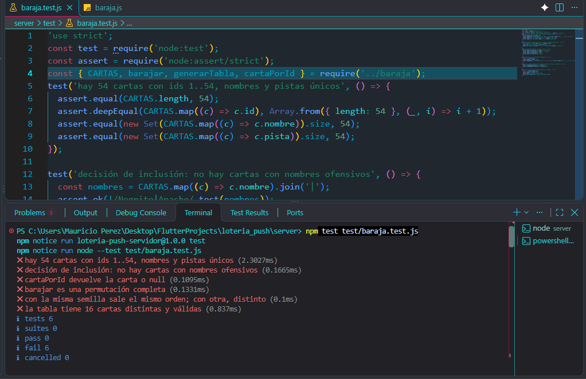
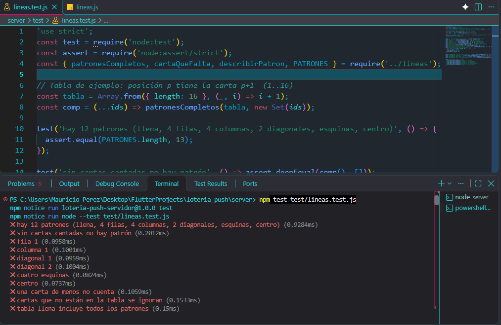
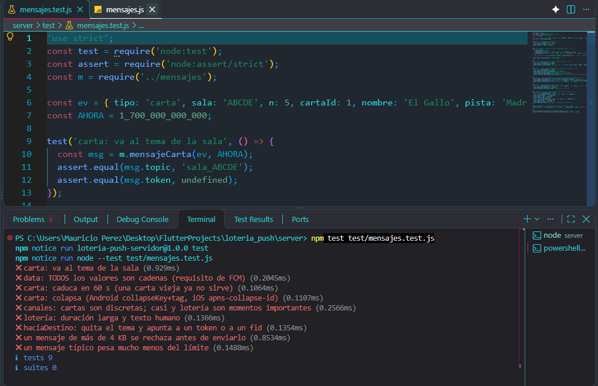
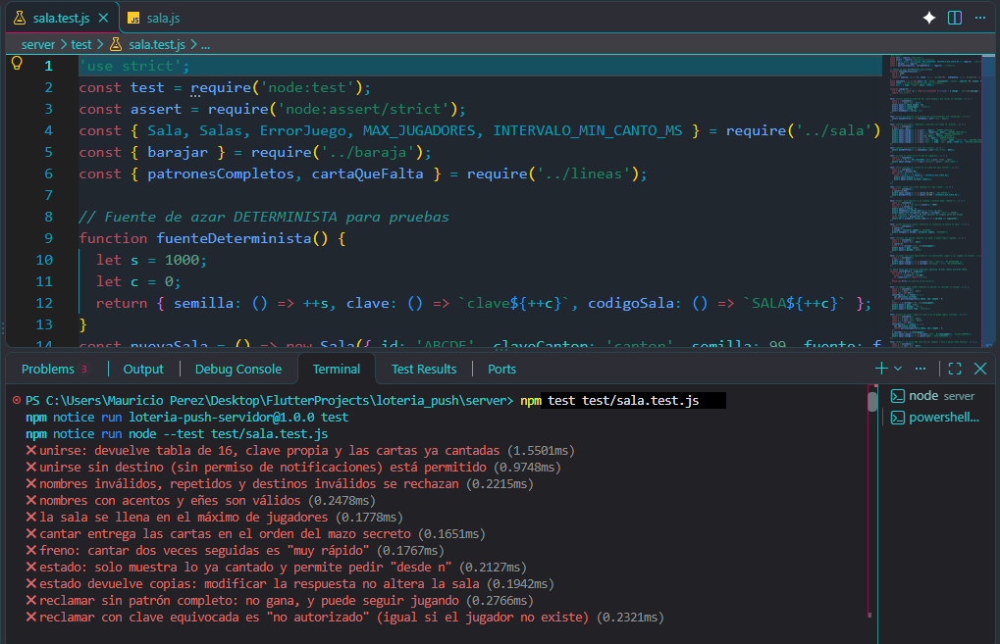
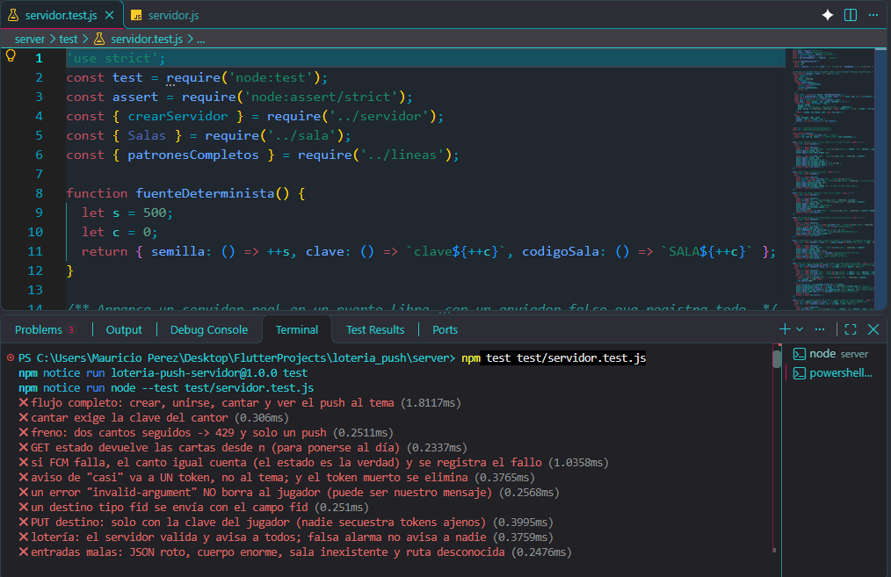
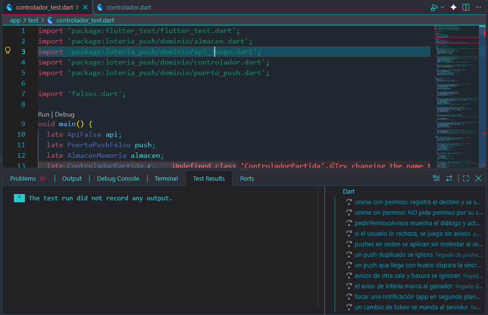
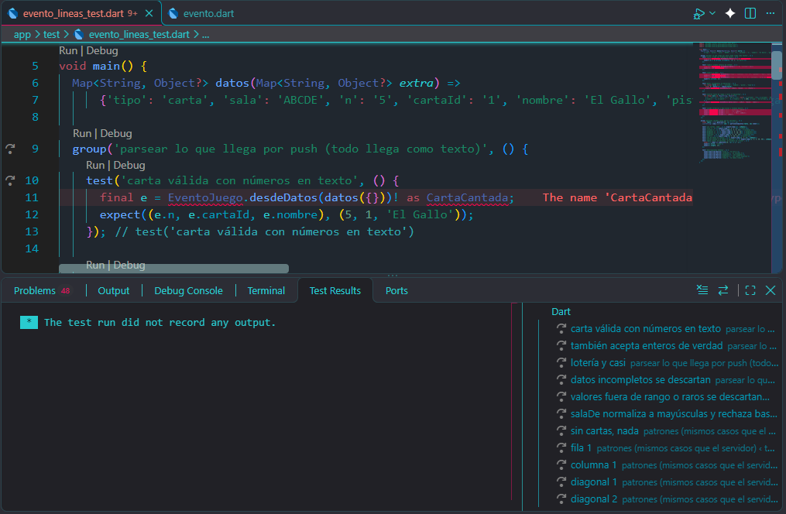
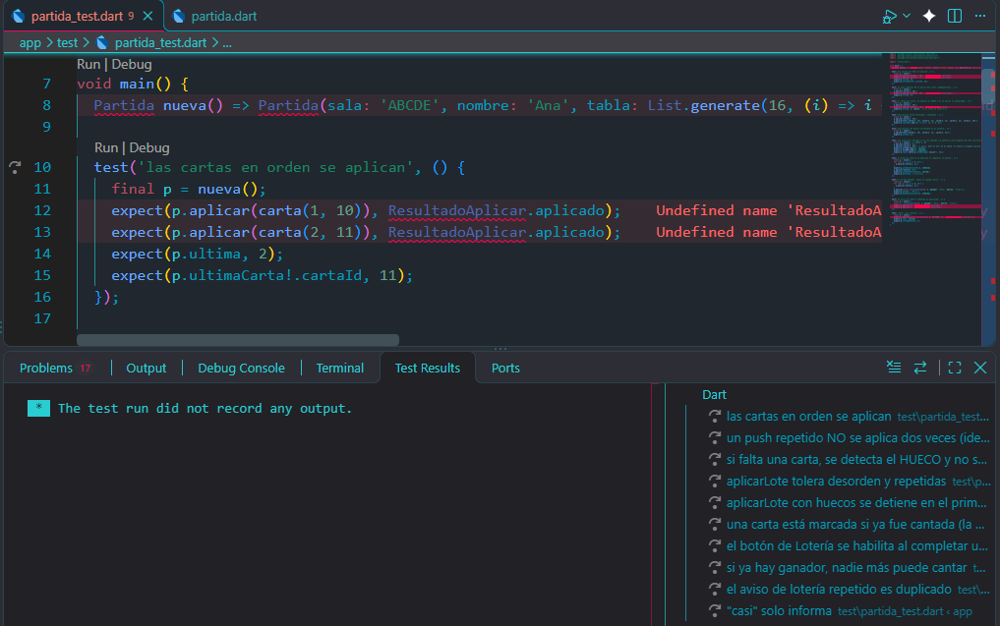

# Lotería Push (notificaciones push con Firebase)

## Pruebas

### Prueba #1

#### Rojo

#### Verde

### Prueba #2

#### Rojo

#### Verde

### Prueba #3

#### Rojo

#### Verde

### Prueba #4

#### Rojo

#### Verde

### Prueba #5

#### Rojo

#### Verde

### Prueba #6

#### Rojo

#### Verde

### Prueba #7

#### Rojo

#### Verde

### Prueba #8

#### Rojo

#### Verde

## Función de aplicacion